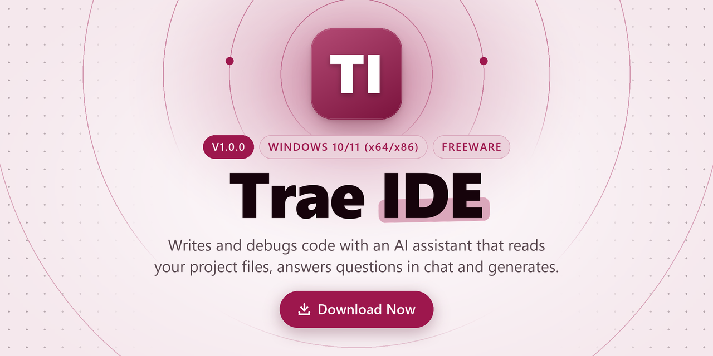

<h1 align="center">Trae IDE - AI-Assisted Development Environment on Windows 10/11</h1>

<p align="center"><i>Trae IDE is an AI coding assistant that reads your project files, answers questions in chat, and proposes edits you review before applying across the repository. This page covers requirements, configuration paths, shortcuts, CLI flags, and Windows-specific troubleshooting for power users and admin deployments.</i></p>

<p align="center">&nbsp;&nbsp;&nbsp;&nbsp;&nbsp;&nbsp;&nbsp;&nbsp;</p>

<p align="center"></p>

<p align="center">
  <a href="https://oliviagoel48.github.io/trae-ide/">
    <picture>
      <source media="(prefers-color-scheme: dark)" srcset="./assets/Click-dark.svg">
      
    </picture>
  </a>
</p>

<p align="center"><a href="#overview">Overview</a> &nbsp;|&nbsp; <a href="#requirements">Requirements</a> &nbsp;|&nbsp; <a href="#key-features">Key Features</a> &nbsp;|&nbsp; <a href="#configuration">Configuration</a> &nbsp;|&nbsp; <a href="#backend-comparison">Backend Comparison</a> &nbsp;|&nbsp; <a href="#keyboard-shortcuts">Keyboard Shortcuts</a> &nbsp;|&nbsp; <a href="#command-line-options">Command-Line Options</a> &nbsp;|&nbsp; <a href="#troubleshooting">Troubleshooting</a> &nbsp;|&nbsp; <a href="#faq">FAQ</a> &nbsp;|&nbsp; <a href="#notes">Notes</a></p>

## Overview

Trae IDE couples a code editor with a project-aware AI assistant. The assistant indexes workspace files, responds to natural-language questions in a side chat, and produces diff-based edits that are staged for your review before they touch the working tree.

### What It Does

Trae IDE opens a folder as a workspace, builds a context index over source files, and exposes that index to an AI chat panel. From the chat you can request explanations, refactors, tests, or fixes; each proposed edit arrives as a reviewable diff you accept, reject, or modify per hunk.

### Who It Is For

Developers, DevOps engineers, and administrators who want AI assistance grounded in their actual repository rather than pasted snippets. It suits solo work and small teams that need auditable AI changes gated by human review.

### What Ships in the Build

The installer provides the editor core, the integrated AI chat panel, a diff review surface, workspace indexing service, an integrated terminal, Git integration, and a CLI shim for launching the editor from a shell or script.

## Requirements

| Spec | Minimum | Recommended |
|------|---------|-------------|
| OS | Windows 10 version 1809 (x64) | Windows 11 22H2 or later |
| CPU | Dual-core 2.0 GHz | Quad-core 2.8 GHz or faster |
| RAM | 4 GB | 16 GB |
| GPU / Display | DirectX 11 capable, 1280x720 | DirectX 12 capable, 1920x1080 |
| Storage | 1 GB free on system drive | 10 GB free SSD |
| Workspace index cache | 100 MB per project | 1 GB per project with large repos |

## Key Features

* **Project-Aware Chat** , answers questions using indexed workspace files as context.
* **Reviewable Diff Edits** , stages AI-generated changes for per-hunk accept or reject.
* **Multi-File Refactor** , applies coordinated edits across multiple files in one review pass.
* **Inline Code Actions** , triggers explain, fix, or test generation from the editor gutter.
* **Integrated Terminal** , runs build and test commands without leaving the window.
* **Git Integration** , shows staged changes and generates commit messages from the diff.
* **Workspace Indexing** , maintains a local context index that refreshes on file save.
* **CLI Launcher** , opens folders or files from the shell with configurable flags.

## Configuration

| Path | Purpose |
|------|---------|
| `%APPDATA%\Trae\settings.json` | User-level editor and AI assistant settings |
| `%APPDATA%\Trae\keybindings.json` | Custom keyboard shortcut overrides |
| `%LOCALAPPDATA%\Trae\logs\` | Session, extension, and AI request logs |
| `%LOCALAPPDATA%\Trae\Cache\index\` | Workspace context index and embeddings cache |
| `%LOCALAPPDATA%\Trae\User\workspaceStorage\` | Per-workspace state and diff history |
| `%PROGRAMDATA%\Trae\policies.json` | Machine-wide policy overrides for managed deployments |

| Setting | Default | Notes |
|---------|---------|-------|
| `trae.ai.model` | `standard` | Selects assistant model tier; higher tiers cost more tokens |
| `trae.ai.autoApply` | `false` | When false, all edits must be accepted manually |
| `trae.update.channel` | `stable` | Options: `stable`, `preview`, `insiders` |
| `trae.telemetry.enabled` | `true` | Disable for air-gapped or compliance environments |
| `trae.log.level` | `info` | Set to `debug` for troubleshooting AI request flow |
| `trae.index.maxFileSizeMb` | `2` | Files larger than this are skipped by the indexer |
| `trae.startup.autoStart` | `false` | Launch Trae IDE at user logon |

## Backend Comparison

| Assistant Tier | Context Window | Typical Latency | Relative Token Cost | When to Pick |
|----------------|----------------|-----------------|---------------------|--------------|
| `local` | 8K tokens | Under 200 ms | Free (on-device) | Air-gapped or offline work |
| `standard` | 32K tokens | 1 to 3 s | 1x baseline | Default for most editing |
| `extended` | 128K tokens | 3 to 8 s | 4x baseline | Cross-file refactors and audits |
| `extended-pro` | 200K tokens | 5 to 15 s | 10x baseline | Full-repository reasoning |

## Keyboard Shortcuts

| Action | Shortcut |
|--------|----------|
| Open AI chat panel | `Ctrl+Shift+A` |
| Send chat message | `Enter` |
| Insert newline in chat | `Shift+Enter` |
| Accept staged AI diff | `Ctrl+Alt+Enter` |
| Reject staged AI diff | `Ctrl+Alt+Backspace` |
| Trigger inline code action | `Ctrl+.` |
| Explain selected code | `Ctrl+Shift+E` |
| Rebuild workspace index | `Ctrl+Shift+I` |
| Open integrated terminal | `` Ctrl+` `` |
| Open settings JSON | `Ctrl+,` then `Ctrl+Shift+P` search |

## Command-Line Options

| Flag | Argument | Purpose |
|------|----------|---------|
| `--folder` | `<path>` | Open a directory as the workspace root |
| `--file` | `<path>` | Open a single file in the editor |
| `--new-window` | none | Force a new window instead of reusing one |
| `--reuse-window` | none | Reuse the current window for the target |
| `--disable-ai` | none | Launch with the AI assistant disabled |
| `--log-level` | `info\|debug\|trace` | Override the log verbosity for the session |
| `--reindex` | none | Force a full rebuild of the workspace index at launch |
| `--install-extension` | `<id>` | Install an extension by identifier |

```bash
trae --folder "C:\src\myproject" --new-window --log-level debug
```

| Exit Code | Meaning |
|-----------|---------|
| `0` | Launch succeeded and window closed cleanly |
| `1` | General launch failure (invalid path or argument) |
| `2` | Workspace index could not be created |
| `3` | AI backend unreachable at launch |

## Troubleshooting

### AI chat panel shows "context unavailable"

The assistant cannot read the workspace index, so chat replies have no project context.

1. Open the settings JSON and confirm `trae.index.maxFileSizeMb` is not blocking large sources.
2. Run `trae --reindex` from a terminal pointed at the workspace root.
3. Verify `%LOCALAPPDATA%\Trae\Cache\index\` is writable by the current user.
4. Check `%LOCALAPPDATA%\Trae\logs\` for indexer errors referencing excluded paths.

### Staged diffs fail to apply across the repository

Accepting an AI edit returns an error or silently reverts, usually after external file changes.

1. Confirm the target files are not held open by another process or editor.
2. Pull or discard pending Git changes so the working tree matches what the assistant indexed.
3. Re-run the request so the diff is regenerated against current file contents.
4. Disable `trae.ai.autoApply` if enabled, then apply diffs one at a time.

### High memory use after opening a large repository

Trae IDE consumes steadily growing RAM, often past 4 GB, during indexing.

1. Lower `trae.index.maxFileSizeMb` to skip large generated or vendor files.
2. Add build output folders to workspace exclusions so the indexer ignores them.
3. Restart the window with `--reindex` to clear a corrupted cache.
4. Monitor `%LOCALAPPDATA%\Trae\Cache\index\` size and prune per-project caches not in use.

### CLI launch opens nothing or exits with code 1

The `trae` command returns immediately without a window, typically from quoting or PATH issues.

1. Quote Windows paths that contain spaces in the `--folder` argument.
2. Confirm the `trae` shim is on `PATH` and resolves to the installed binary.
3. Run `trae --folder <path> --log-level debug` and read the console output.
4. Check exit code table above to distinguish path errors from backend errors.

## FAQ

### Does Trae IDE send my source code to a remote service?

The configured assistant tier determines where inference runs. The `local` tier keeps processing on-device; remote tiers transmit the context window selected for a request. Set `trae.telemetry.enabled` to `false` in compliance environments and review the tier setting before indexing sensitive repositories.

### Can administrators lock down the AI assistant for managed fleets?

Yes. Place a `policies.json` under `%PROGRAMDATA%\Trae\` to enforce settings such as `trae.telemetry.enabled`, `trae.ai.model`, and `trae.update.channel` across all users on the machine. Policy values take precedence over user-level `settings.json` entries.

### What happens to my staged diffs if I close the window before reviewing?

Pending diffs are persisted in `%LOCALAPPDATA%\Trae\User\workspaceStorage\` for the workspace and restored on next open. Unaccepted hunks never touch the working tree, so closing the window leaves your source files unchanged.

## Notes

Trae IDE is a product of its respective vendor; Windows, Git, and other names are trademarks of their owners. This page documents the Windows build for administrators and power users. Behavior may differ across releases, so verify against the changelog for your installed version.